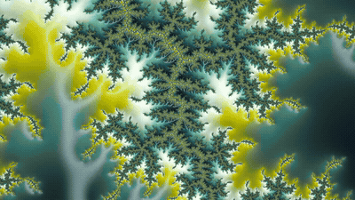
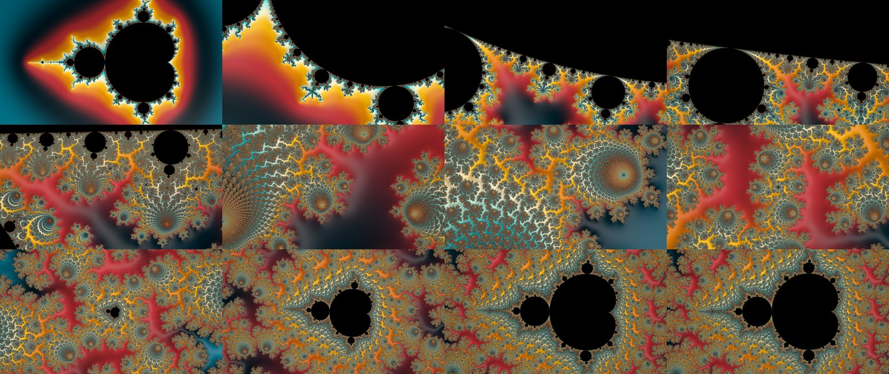
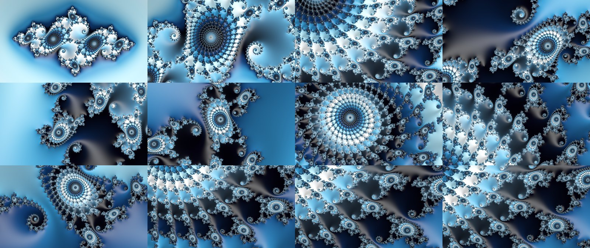
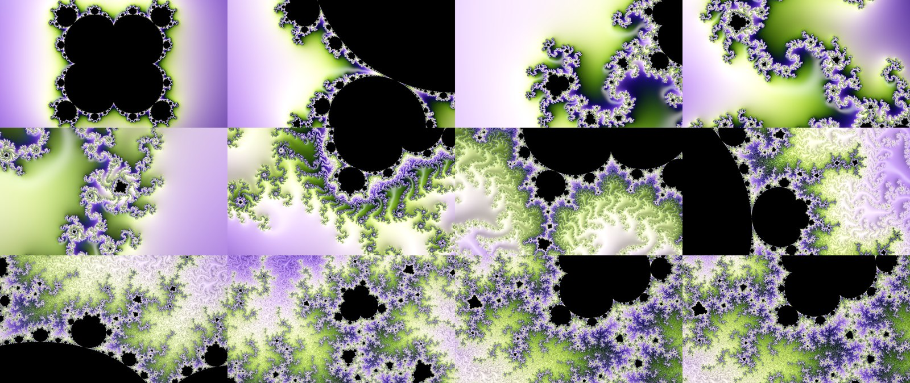
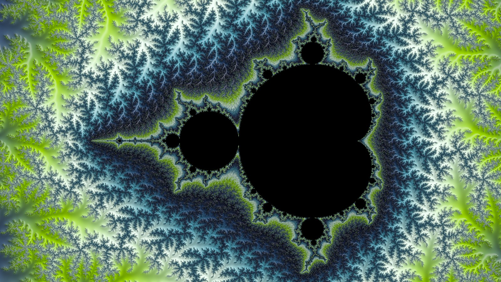
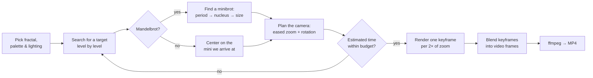

<div align="center">

# 🌀 Fractal Zoom

**Every run makes a new deep-zoom fractal video.**

One command picks a fractal, searches for a spot worth zooming into, and renders a smooth, lit 1080p dive straight to MP4. Mandelbrot zooms go about 10¹¹× deep and end on a real miniature Mandelbrot.




</div>

---

## ✨ Gallery

Each strip below is one generated video, sampled at 12 points from the first frame (top left) to the last (bottom right).

<table>
<tr><td align="center"><b>Mandelbrot</b> · dives into a period-70 minibrot</td></tr>
<tr><td></td></tr>
<tr><td align="center"><b>Julia set</b> · c ≈ −0.749 + 0.114i</td></tr>
<tr><td></td></tr>
<tr><td align="center"><b>Multibrot</b> · z⁵ + c</td></tr>
<tr><td></td></tr>
</table>

<p align="center"><br>
<sub>The last frame of a 2²⁴× Mandelbrot zoom: a tiny copy of the whole set, turned upright.</sub></p>

---

## 🚀 Quick start

```bash
pip install -r requirements.txt     # numpy, numba, pillow, tqdm
# plus ffmpeg on your PATH (https://ffmpeg.org)

python fractal.py                   # one random 1080p zoom  ->  renders/
```

The first run spends a few seconds compiling with Numba. After that, a typical 30-second 1080p video takes **about 3 to 20 minutes** on a 16-thread CPU, depending on the target.

```bash
python fractal.py --preview --count 5     # five quick 640x360 tests
python fractal.py --contact               # a 12-frame preview sheet in about a minute
python fractal.py --seed 2                # re-render a video you liked
python fractal.py --seed 2 --aa 2         # same video with extra anti-aliasing
python fractal.py --fractal julia --palette ice --duration 40
```

Each run saves these files to `renders/`:

| File | What it is |
|---|---|
| `fractal_<type>_<seed>.mp4` | the video (H.264, yuv420p, faststart) |
| `…_poster.png` | a still from 80% of the way in |
| `…_final.png` | the final frame |
| `…json` | every setting, so you can reproduce or tweak the video |

---

## 🎛️ Options

| Flag | Default | Description |
|---|---|---|
| `--seed N` | random | Reproduce a specific video |
| `--count N` | 1 | Make N videos (seeds N, N+1, …) |
| `--width / --height` | 1920×1080 | Output resolution |
| `--fps` | 30 | Frame rate |
| `--preview` | | Shortcut for 640×360 at 24 fps |
| `--fractal` | random | `mandelbrot`, `multibrot`, `multibrot3/4/5`, `julia` |
| `--palette` | random | `classic ice sunset neon emerald lava ocean aurora gold candy silver electric vapor forest cosine` |
| `--depth D` | random | Zoom depth in doublings (about 36 max at 1080p) |
| `--speed S` | ~1.0 | Zoom speed in doublings per second |
| `--duration T` | auto | Zoom length in seconds (overrides speed) |
| `--from-home` | | Always start from the fully zoomed-out view |
| `--aa 1/2/3` | 1 | Extra supersampling per keyframe pixel |
| `--budget M` | 20 | Approximate render-time budget in minutes; slower targets are skipped |
| `--max-iter` | 50000 | Iteration cap (higher means fewer black specks, but slower) |
| `--crf / --preset` | 17 / slow | x264 quality settings |
| `--contact` | | Only render a 12-frame preview sheet |
| `--png-dir DIR` | | Also save every frame as a PNG |
| `--no-video` | | Skip the MP4 |

---

## 🧠 How it works



**Finding a target.** The program starts from the full view and zooms in 8× at a time. At each step it scores candidate spots with small preview renders, looking two levels ahead. Spots that are mostly empty, mostly solid, or pixel-level noise score low. It then checks the whole camera path and rejects any route that passes through a dull stretch.

**Real minibrots.** For the Mandelbrot set it finds the period of a nearby minibrot (the ball method), solves for the minibrot's center with Newton's method, and estimates its size and angle. The video ends with that tiny copy of the set framed in the center and turned upright, so the zoom actually arrives somewhere.

**Lighting.** Each pixel tracks the derivative dz/dc, which gives a surface normal for 3D-style shading with highlights. It also gives a distance estimate, used for dark outlines or a glow on the thin filaments.

**Color that keeps up with depth.** Colors come from log smooth-iteration counts. They are rescaled at each zoom level and smoothed between levels, so every depth uses the whole palette without flickering.

**Keyframe renderer.** Each 2× step of the zoom is rendered once, at high resolution and in linear light. Every video frame is then sampled from those keyframes with mipmapped trilinear filtering, and neighboring keyframes cross-fade. Each keyframe serves about 30 frames, so you get roughly 2× supersampling for about half the cost of rendering frames one by one.

**Speed tricks.** Escaping points stop early with a large bailout radius. Points in the main cardioid and period-2 bulb are skipped with a direct test. Brent periodicity checking, done in z-space, catches points inside minibrots. The iteration limit adapts to each keyframe. Numba runs everything in parallel with dynamic scheduling. Before rendering, the program measures your CPU speed and estimates the render time.

### Limits

* Zoom depth is limited by 64-bit floating point to about 10¹¹ at 1080p. Going deeper would need perturbation theory.
* Paths very close to parabolic points need huge iteration counts. The time budget skips most of them; raise `--budget` to allow them.

---

<div align="center"><sub>Made with Numba, NumPy, Pillow and FFmpeg. Every seed gives a different video.</sub></div>
